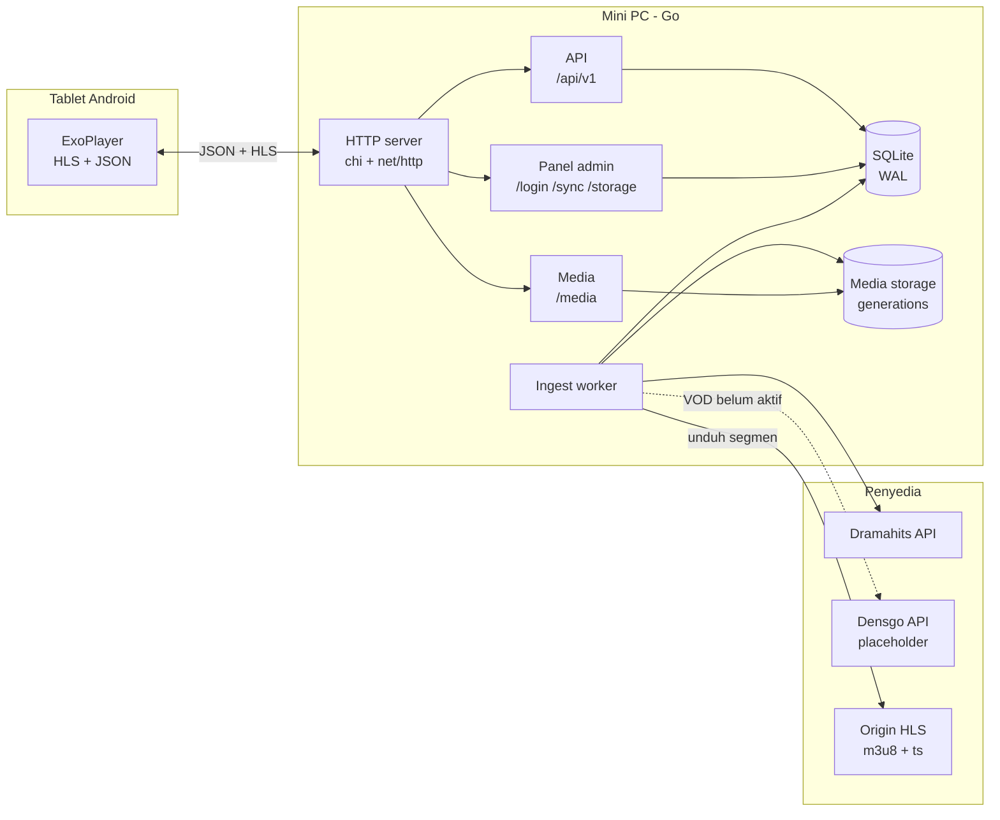

# VodLocal — Server Hiburan Bus

Server hiburan **offline** untuk bus: menyimpan katalog dan media HLS secara lokal,
melayaninya ke tablet Android lewat LAN, dan menyediakan panel admin untuk mengelola
konten, perangkat, dan penyimpanan.

Dibangun sebagai **satu binary Go** dengan **SQLite** tertanam, tanpa nginx/apache,
tanpa Redis, dan tanpa runtime tambahan. Cocok untuk mini PC di dalam bus yang sering
kehilangan koneksi internet.

---

## Daftar Isi

1. [Ringkasan](#1-ringkasan)
2. [Fitur](#2-fitur)
3. [Arsitektur](#3-arsitektur)
4. [Kebutuhan Sistem](#4-kebutuhan-sistem)
5. [Mulai Cepat](#5-mulai-cepat)
6. [Konfigurasi](#6-konfigurasi)
7. [Panel Admin](#7-panel-admin)
8. [API](#8-api)
9. [Alur Playback](#9-alur-playback)
10. [Penyimpanan dan Penghapusan](#10-penyimpanan-dan-penghapusan)
11. [Ingest Konten](#11-ingest-konten)
12. [Deployment](#12-deployment)
13. [Pengujian](#13-pengujian)
14. [Struktur Proyek](#14-struktur-proyek)
15. [Keamanan](#15-keamanan)
16. [Batasan dan Rencana](#16-batasan-dan-rencana)
17. [Lisensi](#17-lisensi)

---

## 1. Ringkasan

| Aspek | Keterangan |
| --- | --- |
| Runtime | Go 1.27 + `net/http` + `chi` |
| Database | SQLite (WAL, `modernc.org/sqlite`, pure Go) |
| Media | HLS (`.m3u8` + `.ts`) disimpan lokal |
| Panel admin | HTML server-rendered + htmx (tanpa CDN) |
| Autentikasi | Bearer token per tablet, session admin + CSRF |
| Deploy | Satu binary + systemd |
| Target | 100 tablet, ±100 jam konten, LAN bus |

Konten berasal dari dua penyedia:

- **Dramahits** → kategori **Short** (aktif).
- **Densgo** → kategori **VOD** (masih placeholder, menunggu kontrak API).

---

## 2. Fitur

- **Katalog offline** — judul, episode, genre, pencarian, dan poster.
- **Pemilihan konten dari panel** — modal List Content dengan tab Short/VOD,
  pagination, checkbox yang bertahan antar-halaman, dan penanda “Sudah ada”.
- **Worker ingest** — mengambil episode dari API, memilih varian video, mengunduh
  segmen, menulis playlist lokal, dan mengaktifkan generation baru.
- **Progres per series** — status, episode selesai/gagal, rendition, byte, persentase,
  langkah terakhir, dan error; dipantau langsung di `/sync/{id}`.
- **Storage per konten** — daftar series beserta ukuran dan progres; hapus per konten
  atau hapus semua konten.
- **Atomic generation switch** — generation baru disiapkan di staging lalu diaktifkan
  dengan `rename`, tanpa menyalin file.
- **Preflight kapasitas disk** — menolak ingest bila pemakaian sudah mencapai ambang.
- **Bersihkan katalog yatim** — title/episode/playable tanpa rendition ikut dihapus.
- **Autentikasi tablet** — registrasi device, token Bearer, rotasi token, nonaktifkan.
- **Progress tonton** — lanjut tonton per perangkat, debounce di klien.
- **Notifikasi sync** — webhook dan Telegram untuk hasil terminal.
- **Alat bantu** — `cmd/loadtest` (uji beban HLS) dan `cmd/devseed` (konten sintetis).

---

## 3. Arsitektur



> Garis putus-putus menunjukkan alur yang belum aktif (Densgo/VOD).

| Komponen | Tanggung jawab |
| --- | --- |
| `internal/api` | Katalog, pencarian, playable, progress, device |
| `internal/httpserver` | Router, auth, media handler, health |
| `internal/admin` | Panel HTML: sync, storage, device, settings |
| `internal/ingest` | Worker pemilihan series + progres per series |
| `internal/dramahits` | Klien API series & episode |
| `internal/hls` | Parser dan rewriter playlist |
| `internal/download` | Unduhan paralel dengan retry dan resume |
| `internal/mediafs` | Layout generation, staging, atomic switch |
| `internal/store` | SQLite, migrasi, pembersihan katalog yatim |
| `internal/notify` | Webhook dan Telegram |

---

## 4. Kebutuhan Sistem

**Build**

- Go 1.27 atau lebih baru.
- SQLite tidak perlu diinstal (driver pure Go).

**Server produksi**

| Item | Rekomendasi |
| --- | --- |
| OS | Ubuntu Server 24.04+ (diuji 26.04) |
| CPU | 2 core (Celeron J3355 cukup untuk server, bukan untuk transcode) |
| RAM | 4–8 GB |
| Disk | 200 GB+ NVMe |
| NIC | Gigabit |
| Jaringan | Switch gigabit + 2–3 AP 5 GHz untuk 100 tablet |

> Router 10/100 Mbps + Wi-Fi 2.4 GHz tidak akan sanggup 100 stream. Server sudah
> diuji lokal pada 100 klien; batas berikutnya adalah jaringan.

---

## 5. Mulai Cepat

```bash
git clone <repo-url> VodLocal
cd VodLocal

go build -o bin/vodlocal ./cmd/server

VODLOCAL_DRAMAHITS_BASE_URL='https://<host-dramahits>/api/v1' \
VODLOCAL_ADMIN_USER=admin \
VODLOCAL_ADMIN_PASSWORD='ganti-password-kuat' \
VODLOCAL_SESSION_SECRET='ganti-dengan-rahasia-acak-minimal-16-karakter' \
./bin/vodlocal
```

`VODLOCAL_DRAMAHITS_BASE_URL` wajib diisi; contoh nilai staging ada di
[`deploy/vodlocal.env.example`](./deploy/vodlocal.env.example).

Untuk development lokal, skrip `scripts/run-local.sh` otomatis memakai URL
staging, admin `admin` / `admin12345`, dan bind ke `127.0.0.1:8080`:

```bash
bash scripts/run-local.sh
```

`make run` memanggil skrip yang sama. Override lewat env, misalnya
`VODLOCAL_ADMIN_PASSWORD='password-lain' bash scripts/run-local.sh`.
Di PowerShell, set environment yang sama lalu jalankan `go run ./cmd/server`.
Di produksi, semua nilai tetap wajib diisi lewat `/var/www/VodLocal/vodlocal.env`.

Admin default hanya dibuat saat tabel `auth_users` masih kosong. Untuk mereset,
hapus `data/app.db` (data lokal, tidak ikut repo).

Buka `http://127.0.0.1:8080/login`, masuk sebagai admin, lalu buka **List Content**
di halaman `/sync` untuk memilih series Dramahits.

Default:

- database `data/app.db`
- media `data/media`
- listen `:8080`

---

## 6. Konfigurasi

Semua konfigurasi memakai environment dengan prefix `VODLOCAL_`. Contoh lengkap ada di
[`deploy/vodlocal.env.example`](./deploy/vodlocal.env.example).

| Variabel | Default | Keterangan |
| --- | --- | --- |
| `VODLOCAL_HTTP_ADDR` | `:8080` | Alamat listen; produksi memakai `:80` |
| `VODLOCAL_DB_PATH` | `data/app.db` | File SQLite |
| `VODLOCAL_MEDIA_ROOT` | `data/media` | Root generation media |
| `VODLOCAL_ARTWORK_ROOT` | `data/media/artwork` | Root artwork legacy; poster baru ada di generation |
| `VODLOCAL_LOG_LEVEL` | `info` | `debug`, `info`, `warn`, `error` |
| `VODLOCAL_SYNC_MAX_PARALLEL` | `8` | Unduhan segmen paralel (1–64) |
| `VODLOCAL_SYNC_RETRIES` | `3` | Percobaan ulang (0–10) |
| `VODLOCAL_SYNC_RETRY_BACKOFF` | `2s` | Backoff awal |
| `VODLOCAL_STORAGE_WARN_PERCENT` | `80` | Ambang peringatan storage |
| `VODLOCAL_STORAGE_BLOCK_SYNC_PERCENT` | `90` | Ambang blokir ingest |
| `VODLOCAL_SESSION_SECRET` | `dev-insecure-secret` | **Wajib diganti di produksi**, min. 16 karakter |
| `VODLOCAL_ADMIN_USER` | *(kosong)* | Admin awal; harus bersama password |
| `VODLOCAL_ADMIN_PASSWORD` | *(kosong)* | Min. 8 karakter |
| `VODLOCAL_NOTIFY_WEBHOOK_URL` | *(kosong)* | Penerima JSON hasil sync |
| `VODLOCAL_TELEGRAM_TOKEN` | *(kosong)* | Token bot Telegram |
| `VODLOCAL_TELEGRAM_CHAT_ID` | *(kosong)* | Chat/topik tujuan |
| `VODLOCAL_DRAMAHITS_BASE_URL` | **(wajib)** | Base API Dramahits; tidak ada default |
| `VODLOCAL_INGEST_MAX_EPISODES` | `0` | Batas episode per series untuk pengujian; `0` = tanpa batas |
| `VODLOCAL_READ_HEADER_TIMEOUT` | `10s` | Timeout header HTTP |
| `VODLOCAL_IDLE_TIMEOUT` | `120s` | Timeout koneksi idle |
| `VODLOCAL_SHUTDOWN_TIMEOUT` | `15s` | Graceful shutdown |

---

## 7. Panel Admin

Akun admin dibuat otomatis saat boot **hanya jika** `VODLOCAL_ADMIN_USER` dan
`VODLOCAL_ADMIN_PASSWORD` diisi serta tabel `auth_users` masih kosong.

| Halaman | Fungsi |
| --- | --- |
| `/` | Ringkasan generation, katalog, storage, device online, sync terakhir |
| `/sync` | Riwayat run, tombol **List Content**, tabel progres per series |
| `/sync/{id}` | Detail run + progres konten (episode, rendition, persen, error) |
| `/devices` | Daftar tablet, nonaktifkan/aktifkan, rotasi token |
| `/storage` | Daftar konten per series, hapus per konten, hapus semua konten |
| `/settings` | Ambang storage, paralelisme sync, jadwal cron |

**List Content.** Modal dengan tab **VOD** (default) dan **Short**. Tab Short memanggil
API Dramahits dengan pagination; checkbox bertahan saat berpindah halaman. Series yang
sudah ada ditandai **Sudah ada** dan tidak bisa dipilih. Tombol **Simpan pilihan**
membuat run ingest baru; tombol **Remove all batch** menghapus seluruh storage dan
katalog terlebih dahulu.

**Waktu.** Semua timestamp di panel ditampilkan dalam **WIB (UTC+7)**. Database tetap
menyimpan UTC.

**Pemicu.** Run manual ditampilkan sebagai `manual`; nama pemicu hanya ditambahkan bila
berbeda dari jenis trigger.

---

## 8. API

Base URL:

- Development: `http://127.0.0.1:8080`
- Produksi: `http://<server>`

Semua response JSON memakai envelope:

```json
{
  "code": 0,
  "msg": "Berhasil",
  "data": {},
  "errors": []
}
```

`code = 0` sukses, `1` sukses sebagian, `>= 1000` error. `errors` selalu array.

**Autentikasi**

| Area | Skema |
| --- | --- |
| `/api/v1/*` (kecuali register) | `Authorization: Bearer <token>` |
| Panel admin | Cookie `mc_session` + field `_csrf` |
| `/media/*` | Tanpa auth (LAN terisolasi) |

**Endpoint utama**

| Method | Path | Auth | Keterangan |
| --- | --- | --- | --- |
| `GET` | `/health`, `/ready` | – | Status proses dan kesiapan |
| `POST` | `/api/v1/devices/register` | – | Registrasi tablet, dapat token |
| `GET` | `/api/v1/devices/me` | Bearer | Info device |
| `POST` | `/api/v1/devices/me/heartbeat` | Bearer | Tandai online |
| `GET` | `/api/v1/genres` | Bearer | Daftar genre |
| `GET` | `/api/v1/titles` | Bearer | Daftar judul + filter |
| `GET` | `/api/v1/titles/{id}` | Bearer | Detail judul |
| `GET` | `/api/v1/titles/{id}/episodes` | Bearer | Daftar episode |
| `GET` | `/api/v1/search` | Bearer | Pencarian judul + episode |
| `GET` | `/api/v1/playables/{id}` | Bearer | Varian, subtitle, URL master |
| `GET` | `/api/v1/playables/{id}/master.m3u8` | Bearer | Master playlist HLS |
| `GET` | `/api/v1/progress` | Bearer | Lanjut tonton |
| `GET` | `/api/v1/progress/{playable_id}` | Bearer | Posisi satu playable |
| `POST` | `/api/v1/progress` | Bearer | Simpan posisi |
| `GET` | `/media/{generation}/{path}` | – | Playlist, segmen, subtitle, poster |

Spesifikasi lengkap, termasuk contoh request/response dan error, tersedia di
[`openapi.json`](./openapi.json) (OpenAPI 3.0.3). Impor langsung ke Postman.

---

## 9. Alur Playback

```text
1. POST /api/v1/devices/register                  (sekali, simpan token)
2. GET  /api/v1/titles?page=1                     (home)
   GET  /api/v1/progress?limit=20                 (lanjut tonton)
   GET  /api/v1/genres                            (filter)
3. GET  /api/v1/titles/{id}/episodes              (series)
   atau first_playable_id pada detail movie
4. GET  /api/v1/playables/{playable_id}           (varian + master_playlist_url)
5. GET  /api/v1/playables/{id}/master.m3u8        (Bearer)
6. GET  /media/{generation}/.../index.m3u8        (tanpa token)
7. GET  /media/{generation}/.../seg-00001.ts      (tanpa token)
8. POST /api/v1/progress                          (tiap ≤20 detik)
```

Player Android memakai ExoPlayer/Media3 `HlsMediaSource`. URL master memerlukan header
Bearer; varian dan segmen tidak.

---

## 10. Penyimpanan dan Penghapusan

### 10.1 Layout

Folder memakai **UUID** dari provider, bukan slug/judul, dan poster berada di dalam
generation:

```text
<VODLOCAL_MEDIA_ROOT>/
├── .building-gen-000043/                 # staging sementara
└── gen-000042/
    └── dramahits/series/<seriesUUID>/
        ├── poster.jpg
        └── <episodeUUID>/<quality>/
            ├── index.m3u8
            └── seg-00001.ts
```

- Fallback bila UUID kosong: slug series dan `s01e01`.
- `titles.poster_path` dan `renditions.playlist_path` relatif terhadap root generation.
- API mengembalikan poster/backdrop/still sebagai `/media/<generation>/<path>`.
- `generations.root_path` menyimpan label relatif, sehingga root media bisa dipindah.

### 10.2 Penghapusan

- **Per konten** — `POST /storage/items/{id}/delete` (`confirm=DELETE`) menghapus folder
  series + poster, renditions, subtitles, dan `generation_items`, lalu membersihkan
  katalog yatim.
- **Semua konten** — `POST /content/purge` (`confirm=PURGE`) menghapus seluruh generation,
  sisa folder `gen-*`/`.building-*`, katalog yatim, dan artwork legacy.
- **Tidak ada masa tenggang.** Generation lama ditandai `retired` dan tetap di disk
  sampai admin menghapusnya. Penghapusan berlaku langsung; playback yang sedang berjalan
  akan gagal pada permintaan berikutnya (`404`).

### 10.3 Kapasitas disk

- Sebelum ingest, pemakaian disk dibandingkan dengan `storage.block_sync_percent`
  (default 90%). Bila sudah mencapai ambang, run ditolak (`507`).
- Staging berada di filesystem yang sama dan commit memakai `rename`, jadi tidak ada
  salinan/ruang ganda untuk file yang baru diunduh saat proses commit.
- Bila disk penuh di tengah run: episode yang gagal ditandai gagal, berkas parsialnya
  dihapus, dan generation tetap di-commit parsial selama ada minimal satu rendition
  `ready`. Bila tidak ada, generation/run ditandai gagal.

---

## 11. Ingest Konten

1. Admin memilih series dari modal **List Content** (tab Short).
2. Worker membuat generation baru + run `selection`.
3. Untuk setiap series, worker mengambil **semua halaman** episode dari API Dramahits.
4. Untuk setiap episode, dipilih stream `device = android` (fallback `ios`).
5. Master playlist diambil, lalu varian dipilih: **sisi pendek ≤ 480** dan terbesar
   yang memenuhi; bila tidak ada, varian terkecil.
6. Playlist ditulis ulang, segmen diunduh, poster series disimpan di folder series.
7. Progres per series ditulis ke `generation_items`.
8. Setelah selesai, generation di-commit, generation lama di-`retired`, katalog yatim
   dibersihkan, dan run ditandai selesai.

**Yang belum ditangani:** subtitle Dramahits (`EXT-X-MEDIA`) dan penyalinan konten lama
ke generation baru saat menambah batch (lihat [Batasan](#16-batasan-dan-rencana)).

---

## 12. Deployment

### 12.1 Build Linux

```bash
CGO_ENABLED=0 GOOS=linux GOARCH=amd64 go build -trimpath -ldflags="-s -w" \
  -o bin/vodlocal-linux-amd64 ./cmd/server
```

### 12.2 Pasang di server

```bash
scp bin/vodlocal-linux-amd64 <ssh-user>@<server-ip>:/tmp/vodlocal

sudo useradd --system --home /var/www/VodLocal --shell /usr/sbin/nologin vodlocal
sudo mkdir -p /var/www/VodLocal/bin /var/www/VodLocal/data
sudo mv /tmp/vodlocal /var/www/VodLocal/bin/vodlocal
sudo chown -R vodlocal:vodlocal /var/www/VodLocal
sudo cp deploy/vodlocal.service /etc/systemd/system/
sudo cp deploy/vodlocal.env.example /var/www/VodLocal/vodlocal.env
sudo editor /var/www/VodLocal/vodlocal.env
sudo systemctl daemon-reload
sudo systemctl enable --now vodlocal
sudo journalctl -u vodlocal -f
```

Unit systemd sudah menyertakan `AmbientCapabilities=CAP_NET_BIND_SERVICE`, sehingga
service dapat listen di port 80 sebagai non-root.

### 12.3 Health check

```bash
curl -fsS http://<server>/health
curl -fsS http://<server>/ready
```

---

## 13. Pengujian

```bash
gofmt -l .
go vet ./...
go test ./...
```

### 13.1 Uji beban

```bash
# buat konten sintetis
go run ./cmd/devseed -db data/app.db -media data/media \
  -titles 4 -episodes 2 -segments 6 -segment-size 262144

# daftarkan device
curl -X POST http://127.0.0.1:8080/api/v1/devices/register \
  -H 'Content-Type: application/json' \
  -d '{"name":"LoadTest","seat_number":"0"}'

# jalankan 100 klien
go run ./cmd/loadtest -base http://127.0.0.1:8080 \
  -playable <playable_id> -token <token> \
  -clients 100 -duration 60s -ramp 10s
```

Hasil terukur di mesin pengembangan (loopback):

| Metrik | Nilai |
| --- | --- |
| Klien | 100 |
| Request | 69.974 |
| Error | 0 |
| Data | 17,0 GiB / 20 detik |
| Throughput | ±7.315 Mbps |
| Latensi p50 / p95 / p99 | 27,2 / 29,5 / 32,6 ms |

Angka ini menunjukkan server bukan bottleneck. Batas sebenarnya ada di jaringan bus.

---

## 14. Struktur Proyek

```text
cmd/server/          entry point + wiring
cmd/loadtest/        CLI uji beban HLS
cmd/devseed/         CLI konten sintetis
internal/response/   envelope & kode
internal/config/     konfigurasi env
internal/store/      SQLite + migrasi
internal/hls/        parser/rewriter playlist
internal/catalog/    kontrak data pemilihan konten
internal/dramahits/  klien API Dramahits
internal/ingest/     worker pemilihan series + progres
internal/provider/   interface upstream + fake
internal/download/   downloader paralel
internal/mediafs/    layout generasi & atomic switch
internal/httpserver/ router, auth, media, health
internal/api/        handler katalog & playback
internal/syncjob/    orkestrasi sync legacy
internal/admin/      panel admin HTML
internal/scheduler/  penjadwal sync berbasis cron
internal/loadgen/    mesin uji beban
internal/notify/     webhook & Telegram
internal/devseed/    pembuat konten sintetis
deploy/              systemd unit + contoh env
openapi.json         spesifikasi OpenAPI 3.0.3
```

---

## 15. Keamanan

- **Ganti `VODLOCAL_SESSION_SECRET` dan password admin** sebelum produksi.
- Panel admin memakai cookie HttpOnly + CSRF double-submit.
- Token device disimpan sebagai SHA-256; token mentah tidak pernah disimpan/di-log.
- `/media/*` sengaja tanpa auth karena LAN bus terisolasi. **Jangan** expose port
  server ke internet.
- Tidak ada TLS lokal. Jika nanti diakses dari jaringan luas, pasang reverse proxy
  dengan TLS.
- Jalankan service sebagai user non-root; systemd unit sudah membatasi filesystem.
- Backup database secara rutin (`sqlite3 app.db ".backup ..."`).

---

## 16. Batasan dan Rencana

| Item | Status |
| --- | --- |
| Densgo / tab VOD | Placeholder, menunggu kontrak API |
| Subtitle Dramahits (`EXT-X-MEDIA`) | Belum diunduh |
| Live streaming | Tidak didukung; sistem ini VOD offline |
| Carry-over generation | Menambah batch baru belum menyalin konten lama ke generation baru |
| Uji 100 stream di jaringan bus | Belum; butuh switch/AP gigabit |
| Importer copy manual | Direncanakan |
| CMS edit metadata | Direncanakan |
| FTS5 | Belum; pencarian memakai `LIKE` (cukup sampai ±50.000 judul) |

**Catatan carry-over:** setiap ingest membangun generation yang hanya berisi series yang
dipilih. Bila menambahkan batch baru tanpa mekanisme carry-over, konten batch lama akan
tertinggal di generation `retired` dan hilang dari katalog aktif. Perbaikan yang
direncanakan: hardlink rendition lama ke generation baru.

---

## 17. Lisensi

Belum ada lisensi publik yang ditetapkan. Hubungi pemilik proyek sebelum menggunakan
atau mendistribusikan kode ini.
