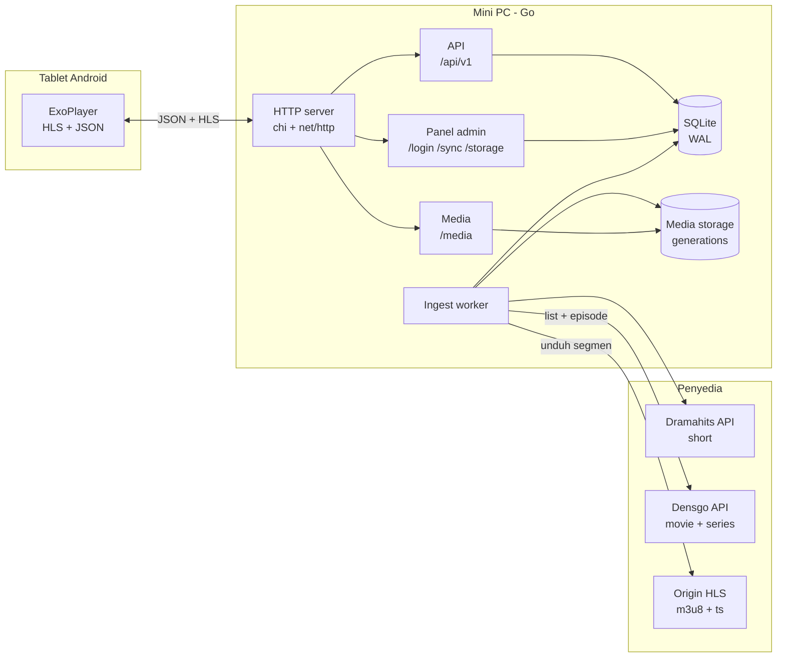

# VodLocal — Server Hiburan Bus

Server hiburan **offline** untuk bus: menyimpan katalog dan media HLS secara lokal,
melayaninya ke tablet Android lewat LAN, dan menyediakan panel admin untuk mengelola
konten, perangkat, dan penyimpanan.

Dibangun sebagai **satu binary Go** dengan **SQLite** tertanam, tanpa nginx/apache,
tanpa Redis, dan tanpa runtime tambahan. Cocok untuk mini PC di dalam bus yang sering
kehilangan koneksi internet.

---

## Daftar Isi

1. [Ringkasan](#1-ringkasan)
2. [Fitur](#2-fitur)
3. [Arsitektur](#3-arsitektur)
4. [Kebutuhan Sistem](#4-kebutuhan-sistem)
5. [Mulai Cepat](#5-mulai-cepat)
6. [Konfigurasi](#6-konfigurasi)
7. [Panel Admin](#7-panel-admin)
8. [API](#8-api)
9. [Alur Playback](#9-alur-playback)
10. [Penyimpanan dan Penghapusan](#10-penyimpanan-dan-penghapusan)
11. [Ingest Konten](#11-ingest-konten)
12. [Deployment](#12-deployment)
13. [Pengujian](#13-pengujian)
14. [Struktur Proyek](#14-struktur-proyek)
15. [Keamanan](#15-keamanan)
16. [Batasan dan Rencana](#16-batasan-dan-rencana)
17. [Lisensi](#17-lisensi)

---

## 1. Ringkasan

| Aspek | Keterangan |
| --- | --- |
| Runtime | Go 1.27 + `net/http` + `chi` |
| Database | SQLite (WAL, `modernc.org/sqlite`, pure Go) |
| Media | HLS (`.m3u8` + `.ts`) disimpan lokal |
| Panel admin | HTML server-rendered + Pico CSS v2.1.1 (vendored, tanpa CDN) |
| Autentikasi | Bearer token per tablet, session admin + CSRF |
| Deploy | Satu binary + systemd |
| Target | 50 tablet per bus, ±100 jam konten, LAN bus |

Konten berasal dari dua penyedia:

- **Dramahits** → kategori **Short** (aktif).
- **Densgo** → kategori **Movie** dan **Series** (aktif).

---

## 2. Fitur

- **Katalog offline** — judul, episode, pencarian, dan poster.
- **Pemilihan konten dari panel** — modal List Content dengan tab **Movie**,
  **Series**, dan **Short (Dramahits)**, pagination, checkbox yang bertahan
  antar-halaman, dan penanda “Sudah ada”.
- **Worker ingest** — mengambil episode dari API, memilih varian video, mengunduh
  segmen, menulis playlist lokal, dan menutup batch unduhan (generation) baru.
- **Progres per series** — status, episode selesai/gagal, rendition, byte, persentase,
  langkah terakhir, dan error; dipantau langsung di `/sync/{id}`.
- **Storage per konten** — daftar series beserta ukuran dan progres; hapus per konten
  atau hapus semua konten.
- **Batch unduhan terpisah** — generation baru disiapkan di staging lalu di-`rename`
  menjadi batch selesai, tanpa menyalin file. Batch hanyalah metadata unduhan.
- **Konten lama tidak pernah tersembunyi** — batch baru tidak menyembunyikan konten batch
  lama: judul tetap tampil dan bisa diputar selama punya minimal satu rendition `ready`
  pada batch mana pun yang sudah selesai. Tidak ada gate “generation aktif”.
- **Preflight kapasitas disk** — menolak ingest bila pemakaian sudah mencapai ambang.
- **Bersihkan katalog yatim** — title/episode/playable tanpa rendition ikut dihapus.
- **Autentikasi tablet** — registrasi device, token Bearer, nonaktifkan, hapus perangkat.
- **Progress tonton** — lanjut tonton per perangkat, debounce di klien.
- **Notifikasi sync** — webhook dan Telegram untuk hasil terminal.
- **Alat bantu** — `cmd/loadtest` (uji beban HLS) dan `cmd/devseed` (konten sintetis).

---

## 3. Arsitektur



| Komponen | Tanggung jawab |
| --- | --- |
| `internal/api` | Katalog, pencarian, playable, progress, device |
| `internal/httpserver` | Router, auth, media handler, health |
| `internal/admin` | Panel HTML: sync, storage, device, settings |
| `internal/ingest` | Worker pemilihan series + progres per series |
| `internal/dramahits` | Klien API series & episode |
| `internal/densgo` | Klien API Densgo (movie & series) |
| `internal/hls` | Parser dan rewriter playlist |
| `internal/download` | Unduhan paralel dengan retry dan resume |
| `internal/mediafs` | Layout generation, staging, atomic switch |
| `internal/store` | SQLite, migrasi, pembersihan katalog yatim |
| `internal/notify` | Webhook dan Telegram |

---

## 4. Kebutuhan Sistem

**Build**

- Go 1.27 atau lebih baru.
- SQLite tidak perlu diinstal (driver pure Go).

**Server produksi**

| Item | Rekomendasi |
| --- | --- |
| OS | Ubuntu Server 24.04+ (diuji 26.04) |
| CPU | 2 core (Celeron J3355 cukup untuk server, bukan untuk transcode) |
| RAM | 4–8 GB |
| Disk | 200 GB+ NVMe |
| NIC | Gigabit |
| Jaringan | Switch gigabit + 2 AP 5 GHz untuk 50 tablet |

> Router 10/100 Mbps atau Wi-Fi 2,4 GHz tidak akan sanggup 50 stream 720p. Untuk 50
> tablet, gunakan 5 GHz; 2,4 GHz hanya layak untuk 360p/480p dengan jumlah penonton
> bersamaan yang lebih kecil. Server bukan bottleneck utama—batasnya di jaringan bus.

---

## 5. Mulai Cepat

```bash
git clone <repo-url> VodLocal
cd VodLocal

go build -o bin/vodlocal ./cmd/server

VODLOCAL_DRAMAHITS_BASE_URL='https://<host-dramahits>/api/v1' \
VODLOCAL_ADMIN_USER=admin \
VODLOCAL_ADMIN_PASSWORD='ganti-password-kuat' \
VODLOCAL_SESSION_SECRET='ganti-dengan-rahasia-acak-minimal-16-karakter' \
./bin/vodlocal
```

`VODLOCAL_DRAMAHITS_BASE_URL` wajib diisi; contoh nilai staging ada di
[`deploy/vodlocal.env.example`](./deploy/vodlocal.env.example).
`VODLOCAL_DENSGO_BASE_URL` sudah diekspor `scripts/run-local.sh` dengan URL
publik Densgo, jadi tidak perlu diisi untuk development.

Untuk development lokal, skrip `scripts/run-local.sh` otomatis memakai URL
staging Dramahits, URL publik Densgo, admin `admin` / `admin12345`, dan bind ke
`127.0.0.1:8080`:

```bash
bash scripts/run-local.sh
```

`make run` memanggil skrip yang sama. Override lewat env, misalnya
`VODLOCAL_ADMIN_PASSWORD='password-lain' bash scripts/run-local.sh`.
Di PowerShell, set environment yang sama lalu jalankan `go run ./cmd/server`.
Di produksi, semua nilai tetap wajib diisi lewat `/var/www/VodLocal/vodlocal.env`.

Admin default hanya dibuat saat tabel `auth_users` masih kosong. Kalau lupa
kata sandi, reset **hanya akun admin** tanpa menghapus katalog:

```bash
# hentikan server dulu, lalu:
go run ./cmd/adminreset -db data/app.db -user admin -password 'password-baru'
```

Buka `http://127.0.0.1:8080/login`, masuk sebagai admin, lalu buka **List Content**
di halaman `/sync` untuk memilih konten Densgo (Movie/Series) atau Dramahits (Short).

Default:

- database `data/app.db`
- media `data/media`
- listen `:8080`

---

## 6. Konfigurasi

Semua konfigurasi memakai environment dengan prefix `VODLOCAL_`. Contoh lengkap ada di
[`deploy/vodlocal.env.example`](./deploy/vodlocal.env.example).

| Variabel | Default | Keterangan |
| --- | --- | --- |
| `VODLOCAL_HTTP_ADDR` | `:8080` | Alamat listen; produksi memakai `:80` |
| `VODLOCAL_DB_PATH` | `data/app.db` | File SQLite |
| `VODLOCAL_MEDIA_ROOT` | `data/media` | Root generation media |
| `VODLOCAL_LOG_LEVEL` | `info` | `debug`, `info`, `warn`, `error` |
| `VODLOCAL_SYNC_MAX_PARALLEL` | `8` | Unduhan segmen paralel (1–64) |
| `VODLOCAL_SYNC_RETRIES` | `3` | Percobaan ulang (0–10) |
| `VODLOCAL_SYNC_RETRY_BACKOFF` | `2s` | Backoff awal |
| `VODLOCAL_STORAGE_WARN_PERCENT` | `80` | Ambang peringatan storage |
| `VODLOCAL_STORAGE_BLOCK_SYNC_PERCENT` | `90` | Ambang blokir ingest |
| `VODLOCAL_SESSION_SECRET` | `dev-insecure-secret` | **Wajib diganti di produksi**, min. 16 karakter |
| `VODLOCAL_ADMIN_USER` | *(kosong)* | Admin awal; harus bersama password |
| `VODLOCAL_ADMIN_PASSWORD` | *(kosong)* | Min. 8 karakter |
| `VODLOCAL_NOTIFY_WEBHOOK_URL` | *(kosong)* | Penerima JSON hasil sync |
| `VODLOCAL_TELEGRAM_TOKEN` | *(kosong)* | Token bot Telegram |
| `VODLOCAL_TELEGRAM_CHAT_ID` | *(kosong)* | Chat/topik tujuan |
| `VODLOCAL_DRAMAHITS_BASE_URL` | **(wajib)** | Base API Dramahits; tidak ada default |
| `VODLOCAL_DENSGO_BASE_URL` | `https://pp.dens.tv:777/index.php/v3070/adps_list_movies_v1` | Base API Densgo (tab Movie & Series) |
| `VODLOCAL_INGEST_MAX_EPISODES` | `0` | Batas episode per series untuk pengujian; `0` = tanpa batas |
| `VODLOCAL_READ_HEADER_TIMEOUT` | `10s` | Timeout header HTTP |
| `VODLOCAL_IDLE_TIMEOUT` | `120s` | Timeout koneksi idle |
| `VODLOCAL_SHUTDOWN_TIMEOUT` | `15s` | Graceful shutdown |

---

## 7. Panel Admin

Panel memakai Pico CSS v2.1.1 sebagai base style. Asetnya di-vendor di
`internal/admin/assets/` dan di-embed ke binary, sehingga tidak ada request CDN
dan tetap berfungsi saat bus offline. Komponen khusus (modal List Content, tabs,
pager, badge, filter, dan tabel scroll) tetap memakai CSS panel.

Akun admin dibuat otomatis saat boot **hanya jika** `VODLOCAL_ADMIN_USER` dan
`VODLOCAL_ADMIN_PASSWORD` diisi serta tabel `auth_users` masih kosong.

| Halaman | Fungsi |
| --- | --- |
| `/` | Ringkasan generation, katalog, storage, device online, sync terakhir |
| `/sync` | Riwayat run, tombol **List Content**, tabel progres per series |
| `/sync/{id}` | Detail run + progres konten (episode, rendition, persen, error, retry) |
| `/devices` | Daftar tablet, nonaktifkan/aktifkan, hapus perangkat |
| `/storage` | Daftar konten per series, hapus per konten, hapus semua konten |
| `/settings` | Batas varian (default 720p), ambang storage, paralelisme sync |

**List Content.** Modal dengan tiga tab: **Movie**, **Series**, dan **Short
(Dramahits)**. Tab Movie/Series memanggil API Densgo, tab Short memanggil API
Dramahits; masing-masing memakai pagination dan checkbox yang bertahan saat
berpindah halaman/tab. Konten yang sudah ada ditandai **Sudah ada** dan tidak bisa
dipilih. Tombol **Simpan pilihan** mengirim daftar `{provider, category, slug}`
terpilih dan membuat run ingest baru; tombol **Remove all batch** menghapus seluruh
storage dan katalog terlebih dahulu.

**Retry konten gagal.** Run yang gagal/parsial menampilkan tombol **Coba lagi semua
konten yang gagal** di `/sync/{id}`, dan tombol **Coba lagi** di setiap baris konten yang
gagal. Retry hanya mengunduh konten yang belum punya rendition `ready` di batch selesai;
setiap retry membuat run + generation baru. Pilihan konten disimpan per run
(`sync_runs.selection_json`), jadi tidak perlu memilih ulang dari List Content. Satu
series yang gagal tidak membatalkan series lain selama ada minimal satu rendition siap.

**Waktu.** Semua timestamp di panel ditampilkan dalam **WIB (UTC+7)**. Database tetap
menyimpan UTC.

**Pemicu.** Run manual ditampilkan sebagai `manual`; nama pemicu hanya ditambahkan bila
berbeda dari jenis trigger.

---

## 8. API

Spesifikasi **API mobile** (endpoint panel admin tidak termasuk) tersedia di
[`openapi.json`](./openapi.json) (OpenAPI 3.0.0). Impor langsung ke Postman.

[`postman_collection.json`](./postman_collection.json) berisi **API mobile** (tanpa endpoint panel admin) dan memakai
collection variable `baseUrl`, `bearerToken`, dan `apiKey`. Isi nilainya sekali di tab
**Variables** collection; seluruh request memakai token yang sama.

Semua response JSON memakai envelope:

```json
{
  "code": 0,
  "msg": "Berhasil",
  "data": {},
  "errors": []
}
```

`code = 0` sukses, `1` sukses sebagian, `>= 1000` error. `errors` selalu array.

**Autentikasi**

| Area | Skema |
| --- | --- |
| `/api/v1/*` (kecuali register) | `Authorization: Bearer <token>` |
| Panel admin | Cookie `mc_session` + field `_csrf` |
| `/media/*` | Tanpa auth (LAN terisolasi) |

**Endpoint utama**

| Method | Path | Auth | Keterangan |
| --- | --- | --- | --- |
| `GET` | `/health`, `/ready` | – | Status proses dan kesiapan |
| `POST` | `/api/v1/devices/register` | – | Registrasi tablet, dapat token |
| `GET` | `/api/v1/devices/me` | Bearer | Info device |
| `POST` | `/api/v1/devices/me/heartbeat` | Bearer | Tandai online |
| `GET` | `/api/v1/titles` | Bearer | Daftar judul + filter |
| `GET` | `/api/v1/titles/{id}` | Bearer | Detail judul |
| `GET` | `/api/v1/titles/{id}/episodes` | Bearer | Daftar episode |
| `GET` | `/api/v1/search` | Bearer | Pencarian judul + episode |
| `GET` | `/api/v1/playables/{id}` | Bearer | Varian, subtitle, URL master |
| `GET` | `/api/v1/playables/{id}/master.m3u8` | Bearer | Master playlist HLS |
| `GET` | `/api/v1/progress` | Bearer | Lanjut tonton |
| `GET` | `/api/v1/progress/{playable_id}` | Bearer | Posisi satu playable |
| `POST` | `/api/v1/progress` | Bearer | Simpan posisi |
| `GET` | `/media/{generation}/{path}` | – | Playlist, segmen, subtitle, poster |

`POST /api/v1/devices/register` mewajibkan `mac_address`. MAC yang sudah terdaftar
ditolak `409`; untuk tablet yang data lokalnya dihapus, hapus perangkat dari panel
`/devices` lebih dulu, lalu tablet register ulang dengan MAC yang sama.

Kalau masih bingung **urutan pemakaiannya**, lanjut ke [9 Alur Playback](#9-alur-playback).
Endpoint di tabel atas bukan daftar yang bisa dipanggil sembarang urutan: tablet harus
register dulu untuk mendapat token, lalu memakai token itu pada request berikutnya.

```text
POST /api/v1/devices/register            -> simpan token Bearer
GET  /api/v1/titles                      -> pilih judul
GET  /api/v1/titles/{id}                 -> detail + daftar episode
GET  /api/v1/playables/{id}              -> varian ready + master_playlist_url
GET  /api/v1/playables/{id}/master.m3u8  -> serahkan URL ke ExoPlayer
POST /api/v1/progress                    -> simpan posisi tiap 10-20 detik
```

Dua kesalahan yang paling sering: (1) memanggil `/api/v1/titles` sebelum register sehingga
dapat `401`; (2) memakai `title_id` pada `POST /api/v1/progress` padahal yang diminta
`playable_id` dari `episodes[].playable_id` atau `first_playable_id`.

**Generation = batch unduhan, bukan gerbang visibilitas**

- `generations` hanya metadata batch unduhan (label, status, ukuran, waktu). Status
  batch **tidak** menentukan apa yang boleh dilihat tablet.
- Konten tampil dan bisa diputar selama punya minimal satu rendition `ready` pada batch
  mana pun yang sudah selesai (`status` bukan `building`/`failed`) — termasuk batch lama.
- Setiap batch tetap tersedia sampai admin menghapusnya. Sync baru hanya menambah batch,
  tidak menyembunyikan atau menghapus batch lama.
- `data.generation` pada `GET /api/v1/playables/{id}` adalah **batch yang menyajikan**
  rendition untuk playable itu, bukan “batch aktif”. Nilainya bisa menunjuk batch lama.
- Path media (`/media/<label>/...`) bersifat **opaque**: klien memakai
  `master_playlist_url` (dan URL di dalam playlist) apa adanya, tidak menyusun path
  sendiri dan tidak menebak label batch.
- `503` · `4009 NO_ACTIVE_GENERATION` sudah tidak dipakai endpoint katalog/playback.
  `/ready` memakai `no_media` bila belum ada batch dengan rendition siap; katalog dan
  playback tetap berjalan dari batch lain yang selesai.


---

## 9. Alur Playback

Alur tablet: **register → daftar judul → detail/episode → playable → master playlist →
progress**. Generation tidak pernah dipakai klien sebagai input; ia hanya informasi batch
pada response.

### 9.1 Register dan status online

```text
POST /api/v1/devices/register
  -> simpan token Bearer di perangkat
  -> semua request /api/v1 memakai Authorization: Bearer <token>
```

Status online tidak memakai endpoint offline. Server menghitung:

- online jika `last_seen_at` ≤ 5 menit;
- offline jika `last_seen_at` lebih lama dari 5 menit atau belum pernah heartbeat;
- `disabled` adalah status admin terpisah (`is_active=0`), bukan offline.

`POST /api/v1/devices/me/heartbeat` dan setiap request `/api/v1` yang terautentikasi
memperbarui `last_seen_at`. Request media `/media/*` **tidak** memperbaruinya. Agar status
online akurat selama menonton:

- kirim `POST /api/v1/devices/me/heartbeat` setiap 60–120 detik, atau
- kirim `POST /api/v1/progress` setiap ≤20 detik—request ini juga memperbarui
  `last_seen_at`.

Menonton film satu jam tanpa heartbeat/progress dapat membuat perangkat tampil offline
setelah 5 menit di panel admin, tetapi **playback tidak diblokir**; status offline hanya
informasi monitoring.

### 9.2 Series

```text
GET /api/v1/titles
  -> GET /api/v1/titles/{id}
  -> GET /api/v1/titles/{id}/episodes?season=1&page=1
  -> pilih episode dengan ready=true, lalu episode.playable_id
  -> GET /api/v1/playables/{playable_id}
  -> GET /api/v1/playables/{playable_id}/master.m3u8  (Bearer token)
  -> ExoPlayer memutar master tersebut
```

Episode dengan `ready=false` tetap muncul di daftar, tetapi jangan langsung diputar;
`GET /playables/{id}` akan membalas `409` · `3003` bila rendition belum siap.

### 9.3 Movie

```text
GET /api/v1/titles/{id}
  -> first_playable_id
  -> GET /api/v1/playables/{first_playable_id}
  -> GET /api/v1/playables/{first_playable_id}/master.m3u8
```

### 9.4 Kenapa `/playables/{id}` dipanggil dulu?

- Mendapat `title`, `episode`, `duration_seconds`, poster/backdrop.
- Mendapat daftar `variants` yang benar-benar `ready`.
- Mendapat daftar `subtitles`.
- Mendapat `master_playlist_url`.
- Bisa menangani `409 / 3003` kalau media belum siap.

Secara teknis bisa langsung ke master kalau sudah punya `playable_id` dan hanya butuh
video, tetapi metadata/subtitle/kesiapan media tidak akan didapat.

### 9.5 Path `/media/...` bukan entry point

Contoh yang mungkin terlihat:

```text
/media/gen-000001/densgo/movie/10129/360p/index.m3u8
```

Itu **URL varian di dalam master playlist**, bukan entry point API. Master playlist yang
dihasilkan `/playables/{id}/master.m3u8` berisi sesuatu seperti:

```text
#EXTM3U
#EXT-X-STREAM-INF:BANDWIDTH=270000,RESOLUTION=640x360
/media/gen-000001/densgo/movie/10129/360p/index.m3u8
```

Mobile harus:

1. Memanggil `master.m3u8` dengan Bearer token.
2. Menyerahkan URL master itu ke ExoPlayer.
3. Membiarkan ExoPlayer mengikuti URI `/media/...` dari dalam master.

Jangan menyusun atau menyimpan path `/media/...` langsung di aplikasi karena:

- path mengandung `generation` yang berubah saat sync ulang;
- memilih kualitas menjadi tanggung jawab client;
- validasi `ready`, subtitle, dan metadata terlewat;
- struktur storage bisa berubah tanpa mengubah API.

`/media/*` memang tidak memakai auth, tetapi bukan kontrak utama. Path media mentah adalah
detail internal server.

### 9.6 Progress

Progress disimpan **per device + per playable**, bukan per judul.

Body yang benar (angka, bukan string):

```json
{
  "playable_id": 9003,
  "position_seconds": 42,
  "duration_seconds": 138,
  "completed": false
}
```

Asal data:

- `playable_id`: `episodes[].playable_id`, `playable.id`, atau `first_playable_id`—bukan
  title ID.
- `position_seconds`: posisi pemutar saat ini dari ExoPlayer.
- `duration_seconds`: durasi media dari player atau `GET /playables/{id}`.
- `completed`: keputusan client, misalnya `true` saat player mencapai akhir atau posisi
  ≥95%.

Wajib: `playable_id` dan `position_seconds`. `duration_seconds` dan `completed` opsional;
`completed` default `false`.

Cara simpan:

- Saat mulai memutar: `GET /api/v1/progress/{playable_id}` untuk resume.
- Kalau belum ada progress, mulai dari 0 (atau `first_playable_id` untuk judul baru).
- Simpan periodik setiap ±10–20 detik, saat pause, saat aplikasi masuk background, dan
  saat selesai.
- `POST /api/v1/progress` bersifat upsert: posisi terbaru menimpa posisi lama.

Kegunaan dua endpoint:

- `GET /api/v1/progress?limit=20` → daftar **Lanjut Nonton** (playable, judul, episode,
  poster, posisi, durasi, persentase, `completed`).
- `GET /api/v1/progress/{playable_id}` → posisi satu playable untuk melanjutkan detik ke
  berapa.

Catatan penting:

- `GET /progress` tidak memfilter `completed=true`; client harus memfilter jika ingin
  menyembunyikan yang sudah selesai.
- Server menghitung `progress_percent` dari `position_seconds / duration_seconds`; jika
  duration tidak dikirim, persentasenya 0.
- `completed` tidak dihitung otomatis server; client yang menentukan.
- Jika `completed=true`, player berikutnya sebaiknya mulai dari awal.

Alur **Lanjut Nonton**:

```text
GET /api/v1/progress
  -> pilih item
  -> GET /api/v1/playables/{playable_id}
  -> GET /api/v1/progress/{playable_id}  (ambil posisi)
  -> GET /api/v1/playables/{playable_id}/master.m3u8
  -> seek ke position_seconds
```

Ringkasnya: **pakai master playlist, bukan path media mentah; simpan progress per
playable; dan pakai progress list untuk Lanjut Nonton.** Generation hanya metadata batch
dan tidak boleh menjadi input playback.

Player Android memakai ExoPlayer/Media3 `HlsMediaSource`. URL master memerlukan header
Bearer; varian dan segmen tidak.

---

## 10. Penyimpanan dan Penghapusan

### 10.1 Layout

Folder memakai **ID dari provider**, bukan slug/judul, dan mengikuti
`<provider>/<category>/<seriesID>/...` dengan `category` = `short` (Dramahits),
`movie`, atau `series` (Densgo). Poster berada di dalam generation:

```text
<VODLOCAL_MEDIA_ROOT>/
├── .building-gen-000043/                    # staging sementara
└── gen-000042/
    ├── dramahits/short/<series-id>/
    │   ├── poster.jpg
    │   └── <episode-id>/<quality>/
    │       ├── index.m3u8
    │       └── seg-00001.ts
    ├── densgo/series/<series-id>/
    │   ├── poster.jpg
    │   └── <episode-id>/<quality>/
    │       ├── index.m3u8
    │       └── seg-00001.ts
    └── densgo/movie/<movie-id>/
        ├── poster.jpg
        └── <quality>/                         # movie tanpa folder episode
            ├── index.m3u8
            └── seg-00001.ts
```

- Fallback bila ID kosong: slug series dan `s01e01`.
- `titles.poster_path` dan `renditions.playlist_path` relatif terhadap root generation.
- API mengembalikan poster/backdrop/still sebagai `/media/<generation>/<path>`.
- `generations.root_path` menyimpan label relatif, sehingga root media bisa dipindah.
- Path lama (mis. `dramahits/series/...`) tetap valid karena database menyimpan path
  relatif; hanya ingest baru yang memakai layout kategori di atas.
- Label generation di path hanya penanda batch pemilik file. Bagi klien path ini
  **opaque**: pakai URL yang diberikan API/playlist, jangan menyusunnya sendiri.

### 10.2 Penghapusan

Kebijakan dasarnya: **setiap batch unduhan tetap tersedia sampai dihapus**. Sync baru
tidak menghapus, tidak menyembunyikan, dan tidak memindahkan konten batch lama.

- **Per konten** — `POST /storage/items/{id}/delete` (`confirm=DELETE`) menghapus folder
  series + poster, renditions, subtitles, dan `generation_items` pada batch tersebut, lalu
  membersihkan katalog yatim. Konten yang masih punya rendition di batch lain tetap bisa
  diputar dari batch itu. Agar konten batch lama juga muncul di `/storage` (dan bisa dihapus
  per konten), server mem-backfill `generation_items` saat boot untuk batch selesai yang
  punya rendition `ready` tetapi belum punya baris item.
- **Per batch** — `POST /storage/generations/{id}/delete` (`confirm=DELETE`, endpoint lama)
  menghapus satu generation beserta direktorinya; katalog yatim ikut dibersihkan. Bisa
  dipakai untuk membuang batch yang sudah tidak diperlukan.
- **Semua konten** — `POST /content/purge` (`confirm=PURGE`) menghapus seluruh generation,
  sisa folder `gen-*`/`.building-*`, dan katalog yatim.
- **Tidak ada masa tenggang dan tidak ada penghapusan otomatis.** Batch lama tetap di disk
  sampai admin menghapusnya. Penghapusan berlaku langsung; playback yang sedang berjalan
  akan gagal pada permintaan berikutnya (`404`).

### 10.3 Kapasitas disk

- Sebelum ingest, pemakaian disk dibandingkan dengan `storage.block_sync_percent`
  (default 90%). Bila sudah mencapai ambang, run ditolak (`507`).
- Staging berada di filesystem yang sama dan commit memakai `rename`, jadi tidak ada
  salinan/ruang ganda untuk file yang baru diunduh saat proses commit.
- Bila disk penuh di tengah run: episode yang gagal ditandai gagal, berkas parsialnya
  dihapus, dan generation tetap di-commit parsial selama ada minimal satu rendition
  `ready`. Bila tidak ada, generation/run ditandai gagal.

### 10.4 Import/Export HDD

Konten yang sudah diunduh dapat diexport ke HDD dan diimport ke server bus lain
melalui panel `/sync`:

- **Export ke HDD** memilih drive tujuan dan konten lokal. Paket ditulis ke
  `<drive>/VOD-EXPORT/<package-id>/` berisi `manifest.json` + file media.
- Konten yang sudah ada di paket pada drive tujuan ditandai **Sudah ada di HDD**;
  penandanya hanya peringatan dan konten tetap bisa diexport ulang.
- **List Content → Offline (HDD)** memindai paket pada drive yang sudah
  di-mount. Pilih konten lalu Import.
- Import membuat generation baru, menyalin ke staging, memverifikasi SHA-256,
  lalu menerbitkannya secara atomik. Batch lama tidak dihapus.
- HDD transport memakai **exFAT**. Di Linux, mount HDD read-only (misalnya
  `/mnt/vod-export`): aplikasi tidak menjalankan `mount` sebagai root; tombol
  Refresh hanya memindai mount point.
- Detail format dan task list ada di
  [`docs/import-export.md`](docs/import-export.md).

---

## 11. Ingest Konten

1. Admin memilih konten dari modal **List Content** (tab Movie, Series, atau Short).
2. Worker membuat generation baru + run `selection`.
3. **Densgo series** — daftar series hanya memberi `id`; `stream_url` pada daftar bernilai
   `null`. Worker wajib memanggil `GET /episodes?seriesId=<id>` dan memakai `stream_url`
   dari tiap episode.
4. **Densgo movie** — tidak ada endpoint episode; `stream_url` pada item daftar langsung
   dipakai sebagai satu playable (`playables.episode_id` NULL).
5. **Dramahits short** — worker mengambil semua halaman episode, lalu memilih stream
   `device = android` (fallback `ios`).
6. Master playlist diambil, lalu varian dipilih: **sisi pendek ≤ 720** dan terbesar
   yang memenuhi; bila tidak ada, varian terkecil. Hanya satu varian yang diunduh.
7. Playlist ditulis ulang, segmen diunduh, poster disimpan di folder konten.
8. Progres per konten ditulis ke `generation_items`.
9. Setelah selesai, generation di-commit menjadi batch selesai (status lama hanya
   memindahkan penanda `active` antar-batch), katalog yatim dibersihkan, dan run ditandai
   selesai. Batch sebelumnya tetap ada di disk dan **tetap tersedia** bagi tablet: konten
   yang tidak ikut di batch baru masih bisa diputar dari batch lamanya sampai admin
   menghapusnya.

**Yang belum ditangani:** subtitle Dramahits (`EXT-X-MEDIA`). Penyalinan konten lama ke
batch baru memang tidak diperlukan lagi: konten lama tidak pernah disembunyikan oleh batch
baru (lihat [Batasan](#16-batasan-dan-rencana)).

---

## 12. Deployment

### 12.1 Build Linux

```bash
CGO_ENABLED=0 GOOS=linux GOARCH=amd64 go build -trimpath -ldflags="-s -w" \
  -o bin/vodlocal-linux-amd64 ./cmd/server
```

### 12.2 Deploy otomatis (Linux)

Dari root repo di server:

```bash
sudo bash scripts/deploy-linux.sh
```

Skrip akan:

- build `bin/vodlocal` bila Go tersedia (atau memakai binary yang sudah ada),
- membuat `vodlocal.env` dengan session secret dan password admin acak,
- membuat user `vodlocal`, permission, dan systemd unit,
- mengecek port, menyalakan service, dan memverifikasi `/health`.

Override lewat environment:

```bash
sudo -E DISABLE_NGINX=1 \
  ADMIN_PASSWORD='password-kuat' \
  DRAMAHITS_BASE_URL='https://host-dramahits/api/v1' \
  bash scripts/deploy-linux.sh
```

`DISABLE_NGINX=1` menghentikan dan men-disable nginx. Env yang sudah ada tidak
ditimpa. Untuk memakai binary hasil build di mesin lain:

```bash
sudo SKIP_BUILD=1 bash scripts/deploy-linux.sh
```

Jika `go` hanya ada di PATH user (bukan di `secure_path` milik sudo), skrip
mendeteksinya lewat `SUDO_USER`. Override manual:

```bash
sudo env GO_BIN="$(command -v go)" bash scripts/deploy-linux.sh
```

### 12.3 Pasang manual (referensi)

```bash
scp bin/vodlocal-linux-amd64 <ssh-user>@<server-ip>:/tmp/vodlocal

sudo useradd --system --home /var/www/VodLocal --shell /usr/sbin/nologin vodlocal
sudo mkdir -p /var/www/VodLocal/bin /var/www/VodLocal/data
sudo mv /tmp/vodlocal /var/www/VodLocal/bin/vodlocal
sudo chown root:root /var/www/VodLocal/bin/vodlocal
sudo chown -R vodlocal:vodlocal /var/www/VodLocal/data
sudo cp deploy/vodlocal.service /etc/systemd/system/vodlocal.service
sudo cp deploy/vodlocal.env.example /var/www/VodLocal/vodlocal.env
sudo editor /var/www/VodLocal/vodlocal.env
sudo chown root:root /var/www/VodLocal/vodlocal.env
sudo chmod 600 /var/www/VodLocal/vodlocal.env
sudo systemctl daemon-reload
sudo systemctl enable --now vodlocal
sudo journalctl -u vodlocal -f
```

Unit systemd sudah menyertakan `AmbientCapabilities=CAP_NET_BIND_SERVICE`, sehingga
service dapat listen di port 80 sebagai non-root.

### 12.4 Health check

```bash
curl -fsS http://<server>/health
curl -fsS http://<server>/ready
```

### 12.5 Update

Jalankan `git pull` sebagai pemilik repo (bukan root), lalu deploy lagi:

```bash
cd /var/www/VodLocal   # sesuaikan dengan lokasi clone
git pull --ff-only
sudo ./scripts/deploy-linux.sh
```

Skrip melakukan build ulang, memasang ulang unit systemd, dan restart service.
Nilai env yang sudah ada tidak ditimpa; bila `VODLOCAL_DENSGO_BASE_URL` belum ada,
skrip menambahkannya otomatis. Kalau `deploy/vodlocal.env.example` berubah,
bandingkan dan tambahkan variabel baru secara manual:

```bash
diff -u deploy/vodlocal.env.example vodlocal.env
```

Database dibackup otomatis ke `data/app.db.bak-<timestamp>` sebelum restart.
Untuk melewati backup: `sudo env SKIP_BACKUP=1 ./scripts/deploy-linux.sh`.
Untuk rollback, checkout commit sebelumnya lalu deploy lagi:

```bash
git checkout <commit-lama>
sudo ./scripts/deploy-linux.sh
```

### 12.6 Auto-mount USB di mini PC Linux

Untuk bus yang juga melakukan export dari Linux, pasang auto-mount USB sekali
per mini PC. Jalankan setelah `deploy-linux.sh` agar user `vodlocal` sudah ada:

```bash
sudo bash scripts/ubuntu-usb-automount.sh
```

Skrip aman dijalankan ulang; file helper, udev rule, dan konfigurasi akan
ditimpa dengan versi yang sama.

Skrip memasang udev rule, dua unit systemd template, dan helper root. Setiap
partisi USB dengan filesystem exFAT/VFAT/NTFS di-mount read-write ke:

```text
/run/media/vodlocal/<uuid>
```

Mount dijalankan oleh unit `vodlocal-usb-mount@.service` yang dipicu udev rule,
bukan langsung dari `RUN` udev: `systemd-udevd` berjalan di mount namespace
sendiri (`PrivateMounts=yes`), sehingga mount dari udev tidak terlihat oleh host
maupun service `vodlocal`. Mount memakai `noexec,nosuid,nodev` dan di-unmount
oleh `vodlocal-usb-unmount@.service` saat disk dicabut. Skrip juga menambahkan
`ReadWritePaths` untuk `/run/media/vodlocal` ke unit systemd agar service
`vodlocal` dapat menulis paket export. Prasyarat Ubuntu: `exfatprogs` untuk
exFAT dan `ntfs-3g`/`ntfs3` untuk NTFS.

Bila disk tidak muncul, cek `findmnt`, `journalctl -t vodlocal-usb`, dan
`systemctl status 'vodlocal-usb-mount@*.service'`.

Jika service `vodlocal` sudah berjalan sebelum installer dijalankan, restart
sekali agar drop-in systemd terbaca:

```bash
sudo systemctl restart vodlocal
```

Ini hanya me-mount disk; tidak menjalankan import atau export otomatis. Setelah
disk terpasang, pilih drive tersebut di modal Import/Export admin.

---

## 13. Pengujian

```bash
gofmt -l .
go vet ./...
go test ./...
```

### 13.1 Uji beban

```bash
# buat konten sintetis
go run ./cmd/devseed -db data/app.db -media data/media \
  -titles 4 -episodes 2 -segments 6 -segment-size 262144

# daftarkan device
curl -X POST http://127.0.0.1:8080/api/v1/devices/register \
  -H 'Content-Type: application/json' \
  -d '{"name":"LoadTest","seat_number":"0"}'

# jalankan 100 klien (benchmark kapasitas; target operasional 50)
go run ./cmd/loadtest -base http://127.0.0.1:8080 \
  -playable <playable_id> -token <token> \
  -clients 100 -duration 60s -ramp 10s
```

Hasil terukur di mesin pengembangan (loopback):

| Metrik | Nilai |
| --- | --- |
| Klien | 100 |
| Request | 69.974 |
| Error | 0 |
| Data | 17,0 GiB / 20 detik |
| Throughput | ±7.315 Mbps |
| Latensi p50 / p95 / p99 | 27,2 / 29,5 / 32,6 ms |

Angka ini menunjukkan server bukan bottleneck. Batas sebenarnya ada di jaringan bus.

---

## 14. Struktur Proyek

```text
cmd/server/          entry point + wiring
cmd/loadtest/        CLI uji beban HLS
cmd/devseed/         CLI konten sintetis
internal/response/   envelope & kode
internal/config/     konfigurasi env
internal/store/      SQLite + migrasi
internal/hls/        parser/rewriter playlist
internal/catalog/    kontrak data pemilihan konten
internal/dramahits/  klien API Dramahits
internal/densgo/     klien API Densgo (movie & series)
internal/ingest/     worker pemilihan series + progres
internal/provider/   interface upstream + fake
internal/download/   downloader paralel
internal/mediafs/    layout generasi & atomic switch
internal/httpserver/ router, auth, media, health
internal/api/        handler katalog & playback
internal/syncjob/    orkestrasi sync legacy
internal/admin/      panel admin HTML + Pico CSS
internal/loadgen/    mesin uji beban
internal/notify/     webhook & Telegram
internal/devseed/    pembuat konten sintetis
deploy/              systemd unit + contoh env
scripts/             run-local.sh + deploy-linux.sh
openapi.json         spesifikasi OpenAPI 3.0.0 untuk API mobile (tanpa admin)
```

---

## 15. Keamanan

- **Ganti `VODLOCAL_SESSION_SECRET` dan password admin** sebelum produksi.
- Panel admin memakai cookie HttpOnly + CSRF double-submit.
- Token device disimpan sebagai SHA-256; token mentah tidak pernah disimpan/di-log.
- `/media/*` sengaja tanpa auth karena LAN bus terisolasi. **Jangan** expose port
  server ke internet.
- Tidak ada TLS lokal. Jika nanti diakses dari jaringan luas, pasang reverse proxy
  dengan TLS.
- Jalankan service sebagai user non-root; systemd unit sudah membatasi filesystem.
- Backup database secara rutin (`sqlite3 app.db ".backup ..."`).

---

## 16. Batasan dan Rencana

| Item | Status |
| --- | --- |
| Densgo series | `stream_url` pada daftar bernilai `null`; URL m3u8 wajib diambil dari `GET /episodes?seriesId=<id>` per episode |
| Varian video | Hanya satu varian terpilih (sisi pendek ≤ 720p) yang diunduh dan disimpan |
| Subtitle Dramahits (`EXT-X-MEDIA`) | Belum diunduh |
| Live streaming | Tidak didukung; sistem ini menyimpan konten on-demand secara offline |
| Banyak batch per konten | Didukung: konten tetap tersedia selama punya rendition `ready` di batch mana pun yang selesai. **Tidak perlu** carry-over/hardlink |
| Uji 50 stream di jaringan bus | Belum; butuh switch/AP 5 GHz |
| Importer copy manual | Direncanakan |
| CMS edit metadata | Direncanakan |
| FTS5 | Belum; pencarian memakai `LIKE` (cukup sampai ±50.000 judul) |

**Catatan batch.** Setiap ingest membangun generation yang hanya berisi series yang
dipilih, tetapi batch itu **tidak** menentukan isi katalog. Katalog dan playback memakai
syarat “minimal satu rendition `ready` pada batch mana pun yang sudah selesai”, sehingga
konten batch lama tetap tampil dan tetap bisa diputar setelah batch baru masuk. Generation
hanya metadata batch unduhan: labelnya dipakai untuk menyusun `root_path`/URL media (opaque
bagi klien), bukan untuk menyembunyikan konten. Karena itu carry-over tidak diperlukan;
yang perlu dijaga hanyalah kapasitas disk, dan admin menghapus konten/batch secara manual
lewat `/storage` saat ruang menipis.

---

## 17. Lisensi

Belum ada lisensi publik yang ditetapkan. Hubungi pemilik proyek sebelum menggunakan
atau mendistribusikan kode ini.
